

I am continually uplifted by those I care for and respect: my parents, teachers, and peers. My parents always tell me that family will always be my safe harbor, and they have guided me through countless bouts of anxiety. My teachers have devoted substantial time to mentoring me, imparting not only knowledge, research intuition, and rigorous methodologies, but also invaluable life lessons. Together with my peers, we grow and progress side by side: we burn the midnight oil over coursework, research projects,  GRE preparation, and graduate application discussions, supporting one another through anxious moments.

<table class="blog-index"><thead><tr><th>Date</th><th>Entry</th></tr></thead><tbody>
<tr><td>2026-10-01</td><td><a href="#simulation-telescope">A Telescope Built from Simulations</a></td></tr>
<tr><td>2026-09-07</td><td><a href="#protein-to-patient">From a Protein Sequence to a Patient’s Future</a></td></tr>
<tr><td>2026-09-01</td><td><a href="#final-year-project">A Brand New Semester and also last year at XJTLU</a></td></tr>
<tr><td>2026-08-17</td><td><a href="#seminar">Three years of stat & public-health seminars</a></td></tr>
<tr><td>2026-07-15</td><td><a href="#jcsds">The 4th JCSDS and Prof. Jianqing Fan's autograph "Statistics is SURE for you"</a></td></tr>
<tr><td>2026-06-01</td><td><a href="#hard-code">Does Hard Coding Matter Less Now?</a></td></tr>
<tr><td>2026-03-30</td><td><a href="#warm-help-center-again">Back at the Warm Help Center</a></td></tr>
<tr><td>2026-03-24</td><td><a href="#zeng-guofan">Zeng Guofan's Six Admonitions</a></td></tr>
<tr><td>2026-03-20</td><td><a href="#travel-app">Suzhou Smart Travel Maker</a></td></tr>
<tr><td>2026-01-10</td><td><a href="#interpretable-statistics-ai">Interpretable Statistics and Interpretable AI</a></td></tr>
<tr><td>2025-12-11</td><td><a href="#warm-help-center">Warm Help Center: learning together</a></td></tr>
<tr><td>2025-09-01</td><td><a href="#math-stat-empathy">Math/Stat-related things has empathized me a lot</a></td></tr>
<tr><td>2025-03-22</td><td><a href="#spring-ride">A spring ride by the lake</a></td></tr>
<tr><td>2024-10-09</td><td><a href="#michael-levitt">A wonderful life in science</a></td></tr>
<tr><td>2024-09-25</td><td><a href="#akun">Wednesday mathematics by Prof. Akun</a></td></tr>
<tr><td>2024-07-26</td><td><a href="#uniform">Uniform generates everything</a></td></tr>
<tr><td>2024-03-26</td><td><a href="#youth">Youth and adventure</a></td></tr>
</tbody></table>

<article class="blog-entry" id="simulation-telescope">
<h2>A Telescope Built from Simulations</h2>

<em>Why I choose questions that take time to answer</em>

2026-10-01 · Includes later reflections and sources through October 2026

曾经，我可以继续把一篇 AI 会议论文扩展成期刊论文。但我想去试试数理统计。在此之前，我已经体验过公共卫生和 AI，而这些经历让我开始好奇：自己使用的方法之下，究竟有怎样的推理。

转向数理统计的时候，我并没有看清目的地。它有自己的节奏。我经历过投稿之后漫长的等待，也经历过等了六个月后收到拒稿。当进展不再表现为一个新的实现，或者一次性能指标的提升时，它就变得不那么容易辨认。

我记得有一次，和导师讨论一个假设检验的方案，从晚上七点一直谈到十点。留在记忆中的，是我们花在澄清问题上的时间：假设究竟应该表达什么，方法需要保证什么，论证中的哪一部分还要继续完善。我开始从那些不能靠让代码跑起来就解决的问题中，体会到快乐。

经常，我听到的不是一个数学上的保证，而是一份邀请，让我重新回到问题面前。那时，我对前方的领域还了解得很少，但这份鼓励让我能够想象自己在其中的未来。我想到一片仍被坚冰覆盖的北海，以及岸边意外盛开的梅花。

阅读 Bradley Efron 与 Trevor Hastie 的《Computer Age Statistical Inference》，让我把这份个人的不确定感放进了一段更长的历史。他们的叙述穿过经典推断、收缩估计、经验贝叶斯、重抽样与现代算法。计算机革命拓展了统计学家能够尝试的事情，而有关证据的老问题，仍然活跃在新方法之中。<a href="#essay-ref-casi">casi</a>

我喜欢书中那架载着读者回望历史的小飞机。从高处看，站在地面上仿佛彼此竞争的学派，开始显现出联系。James–Stein 估计与经验贝叶斯展示了相关问题之间如何共享信息，后来的计算方法又打开了其他道路。这样的演变，比一代代更强大的机器依次登场，要有意思得多。

Jackknife 与 bootstrap 让这种联系变得格外具体。在普通的逐一删除 jackknife 中，我每次删去一个观测，再看估计值如何变化。在针对独立观测的普通非参数 bootstrap 中，我从已观察的数据里有放回地抽样，重新计算统计量。这些变化可以帮助近似抽样不确定性。<a href="#essay-ref-bootstrap">bootstrap</a>

Bootstrap 把困难计算中的很大一部分，转化为重复计算。对于某些问题，推导明确的抽样分布十分棘手，而反复计算一个估计量却是可行的。但统计思想仍然不可或缺：我们是在用经验分布代替未知的总体分布，仍然需要理由相信，这种替代适用于眼前的问题。<a href="#essay-ref-bootstrap">bootstrap</a>

这个细节对我很重要，因为它避免了一种容易出现的误解。计算机降低了重复的成本，却不会让每一次重复都产生有用的信息。例如，把相互依赖的观测当作独立观测来重抽样，就可能保留了错误的数据特征。计算能力创造了新的可能，而这些可能仍然需要与假设相匹配。

Cox 模型也讲述着一个相近的故事。偏似然是一项概念上的成就，而模型拟合所需的数值工作，又使计算实现变得重要。Cox 后来曾回忆，统计软件包收录这一方法，帮助它得到了广泛应用。<a href="#essay-ref-coxreflection">coxreflection</a>在这两个例子中，我看见同一种合作关系：数学结构赋予计算目的，计算则让数学结构获得实际的影响力。

Simulation 让我切身体会到了这种关系。我不必一开始就拥有 Fisher 那样的直觉，才有资格探索一个新方法是否表现合理。我可以设定数据生成机制，重复实验，再观察偏差、覆盖率或拒绝频率。推导中不容易看见的东西，有时会在一连串失败的模式里变得清楚。

所以，我把模拟想象成一架望远镜。它让我看得比单凭直觉更远。当我亲自设定真实参数时，就暂时站到了真实研究中难以拥有的位置：我知道这个方法试图找回的答案。我可以看着估计量偏离它，再追问为什么。

然而，这种仿佛从上方俯瞰的视角，只存在于我自己构造的世界里。如果我省略了困难的情形，望远镜对准的，就是一片经过精心布置的星空。十万组模拟数据或许能让我很了解这片天空，却未必能告诉我另一片天空是什么样子。模拟本身也有抽样误差，而数据生成的假设，终究是我设定的。

渐近理论提供了另一种看得更远的方式。它在明确的条件下，描述方法沿着特定极限序列的表现。我觉得这种精确很美，同时也想知道，在实际拥有的样本量下，这个近似究竟表现如何。模拟可以显示，什么时候极限是一个有用的指引，什么时候收敛太慢，还不足以让人安心。证明则可以解释，为什么某种规律能够延伸到我尚未测试的情形。

推导一个序贯假设检验的拒绝域时，这些关切汇聚到了一起。证据会随着时间积累，决策规则也可能根据已经观察到的信息作出调整。问题于是变成：怎样在不断学习的同时，仍然对犯错的概率保有可辩护的控制？

这也是 POPPER 吸引我的原因。在 2025 年介绍这一框架的论文中，语言模型智能体提出并执行检验，考察较宽泛假设中可测量的推论。序贯检验框架负责汇总证据，并在相应假设成立时控制第一类错误。<a href="#essay-ref-popper">popper</a>这个项目让我感兴趣，是因为它让推断问题变得更加无法回避：当一个智能体能够不断提出分析方案时，我们必须把选择分析与停止分析的过程本身也考虑进去。

e-value 为理解这套理论提供了一个入口。如果非负统计量 \(E\) 对于零假设分布族 \(\mathcal H_0\) 满足

\[
  \sup_{P\in\mathcal H_0}\mathbb E_P[E]\leq 1,
\]

那么它就是这个零假设分布族下的一个 e-variable。根据 Markov 不等式，对于任意 \(P\in\mathcal H_0\) 和 \(0&lt;\alpha&lt;1\)，都有

\[
  P(E\geq 1/\alpha)\leq
  \alpha\,\mathbb E_P[E]\leq\alpha.
\]

因此，较大的取值可以提供反对零假设的证据。<a href="#essay-ref-safe">safe</a>这段简短的论证很吸引我：错误率保证，来自一个清楚陈述的期望上界。

序贯有效性还需要进一步的结构。例如，设非负因子 \(E_t\) 关于时刻 \(t\) 已有的信息 \(\mathcal F_t\) 可测，并且满足

\[
  \mathbb E_P[E_t\mid\mathcal F_{t-1}]\leq 1
  \quad\text{对每个 }P\in\mathcal H_0,
\]

那么，以 1 为初值、依次累乘这些因子得到的过程，就是一个非负检验超鞅。在零假设分布族中的每个分布下，Ville 不等式保证，这个过程曾经达到 \(1/\alpha\) 的概率不超过 \(\alpha\)。<a href="#essay-ref-savi">savi</a>这里的条件期望要求至关重要：把若干单独有效的固定时点检验放在一起，并不会自动允许我们无限制地反复查看结果。

比起把 e-value 简单称为一种新的 p-value，这让我有了更准确的理解。它们的校准方式不同；如果希望反复监测普通的固定样本 p-value，就需要适当的序贯方法。任何一种量，都不能替分析补上缺失的科学假设。如果 AI 智能体选错了检验，或者把重复使用的数据当成新的证据，再漂亮的数学符号也修复不了这个问题。

在非劣效试验中，这些区别最终又回到具体选择：非劣效界值、感兴趣的治疗效应、分析人群，以及监测方案。FDA 指南与 ICH E9 都把统计推理放在试验设计和解释之中。<a href="#essay-ref-ni">ni</a>, <a href="#essay-ref-e9">e9</a>更换一种证据度量，并不会免除这些责任。

Efron 和 Hastie 用一句令人难忘的话概括了这种关系：“算法是统计学家所做的事情，而推断说明他们为什么这样做。”<a href="#essay-ref-casi">casi</a>我把这句话理解为一种邀请，让我更充分地理解自己的工作。数据科学、机器学习与统计学彼此交叠，而真正让我停下来思考的，是一个结论的依据，以及这些依据的边界。

我也希望阅读带给我的，不只是解决眼前问题的工具。一本有用的书能够解决今天的困难，而更深入的阅读体验，会改变我注意到哪些困难，最终帮助我提出属于自己的问题。这正是我希望逐渐形成的独立性。

有时，我觉得自己的理解像一个边缘分布：它只提供局部视角，仍有大量联合结构隐而未现。再强大的望远镜，也只是赋予我一个观察方向，并不能让我拥有整片星空。当一段推导、一次模拟或一个细致的解释，让其中一小片天空变得可以理解时，我依然会感到一种令人愉悦的惊奇。

统计学对我的吸引力，就在于我们能够在这种不完整之中认真工作。我们可以说清假设，揭示失败，并让一个结论所带的不确定性拥有明确的含义。世界始终大于我们的模型。我想继续学习，如何凝视它。

</article>

<article class="blog-entry" id="protein-to-patient">
<h2>From a Protein Sequence to a Patient’s Future</h2>

<em>How biological prediction led me to causal questions</em>

2026-09-07 · Includes later reflections and sources through October 2026

蛋白质序列是一串字母，但只有当我们开始追问这些字母能告诉我们什么时，它与语言的相似性才真正变得有趣。每个字母代表一种氨基酸，而它们的排列与蛋白质如何折叠、相互作用、发挥功能有关。初次接触蛋白质语言模型时，吸引我的是这样一种可能：序列中的模式，或许能透露生命组织自身的某些规律。

蛋白质语言模型，即 PLM，从大量蛋白质序列中学习。例如，学习还原被遮盖的氨基酸，会促使模型捕捉序列中不同位置之间的关系。研究表明，由此得到的表征可以包含与生物结构和功能有关的信息。<a href="#essay-ref-plm">plm</a>这让我感到惊奇：一个定义在序列上的学习目标，竟能产生有助于回答序列之外问题的表征。

不过，语言的类比也有边界。蛋白质是处于具体环境中的物理实体，有用的表征本身并不能确立分子机制。一位做分子动力学与可解释 AI 的生物信息学朋友，让我对这段距离更感兴趣。一个结构、一条运动轨迹和一种解释，回答的是不同的问题。我想理解，证据如何在它们之间建立联系。

个性化 mRNA 癌症疫苗，让这种兴趣有了更具体的落点。“个性化疫苗”最初听起来精细得几乎不可思议：围绕某一个人肿瘤中的突变，设计一套治疗。顺着设计过程往下看，这件事才逐渐变得清楚。

这一过程从肿瘤的信息开始，往往还需要结合正常组织的信息。研究人员识别肿瘤特异性突变，再判断哪些突变可能产生有用的免疫靶点。计算方法帮助预测候选新抗原并进行优先排序，其中包括考虑相关肽段能否被呈递给免疫细胞。选出的靶点随后用于指导 mRNA 治疗的设计，以期激发抗肿瘤免疫反应。<a href="#essay-ref-neoantigens">neoantigens</a>

在这里，算法可以帮助缩小庞大的生物学搜索范围。与此同时，给候选目标排序与证明它能带来获益，是两件不同的事。蛋白质语言模型属于计算生物学的广阔图景，但它们的存在，并不意味着某一款疫苗的筛选系统就使用了 PLM。即使整个故事令人兴奋，我也希望把这些区别保留清楚。

临床证据让这个故事更有分量。2026 年 8 月，Merck 与 Moderna 宣布 INTerpath-001 获得 III 期阳性结果。这项试验评估了个体化新抗原疗法 intismeran autogene（也称 V940）联合帕博利珠单抗，用于高风险黑色素瘤患者术后的治疗。<a href="#essay-ref-vaccineoverview">vaccineoverview</a>两家公司在 10 月的报告中指出，与单用帕博利珠单抗相比，联合方案改善了无复发生存和无远处转移生存。报告中的无复发生存风险比为 0.58，95% 置信区间为 0.45 至 0.75；总生存数据当时仍未成熟。<a href="#essay-ref-vaccineresults">vaccineresults</a>

这些细节改变了我对“成功”二字的理解。结论对应的是特定终点、特定人群，以及特定的治疗比较。试验评估的是整套治疗策略，并没有单独识别计算筛选算法贡献了多少。一个有利的风险比，也不意味着每位接受治疗的患者都会获益，更不意味着已经证明能够治愈癌症。

我的健康数据科学兴趣，正是在这里逐渐转向了对统计推断的着迷。设计出一种治疗之后，我们仍然需要追问：患者实际经历了什么，与没有接受这种治疗时可能经历的情况相比，又有什么不同？预测一个肿瘤的特征是一种知识，而治疗效应的证据需要另一种论证。

Cox 比例风险模型，为这些问题提供了一个优雅的入口：

\[
  h(t\mid x)=h_0(t)\exp(x^\top\beta).
\]

这里的风险率，描述的是在时刻 \(t\) 之前尚未发生事件的人群中，事件发生的瞬时速率。回归系数刻画协变量在对数风险率尺度上的关联，而基准风险函数 \(h_0(t)\) 的形式并不预先指定。有限维参数与未指定形式的函数相结合，正是这个模型被称为半参数模型的原因。<a href="#essay-ref-cox">cox</a>

吸引我的是这种建模上的克制。它为协变量效应提供了清楚的结构，又不要求完整指定生存时间的分布。偏似然使我们能够在不预先指定基准风险函数的情况下估计回归系数。这背后是数学思想，而把它用于真实数据，还需要构造风险集并进行数值优化。<a href="#essay-ref-cox">cox</a>理论与计算，就这样在一次看似普通的模型拟合中相遇。

这种可解释性也有条件。恒定的风险比依赖比例风险假设，而风险比并不是生存概率的绝对差异。即使一个系数的含义很透明，它也不会自动获得因果解释。研究设计、治疗分配、删失，以及究竟想回答什么因果问题，都会影响结论。

因果推断为最后这个问题提供了一套语言。对于同一位患者，我可以设想其接受一种治疗时的结局，也可以设想其接受另一种治疗时的结局，但最终只能观察到其中一个。在患者群体之间，随机分配有助于建立可信的比较；使用观察性数据时，要识别因果效应，还需要充分控制混杂、一致性和正值性等额外假设。<a href="#essay-ref-causal">causal</a>预测精度再高，也不能让那个缺失的反事实变成直接可观察的事实。

因此，我不再把因果推断简单理解为模仿一场随机试验。目标试验可以帮助明确观察性研究试图回答的问题，但数据本身仍然必须能够支持这个问题。选择结局、治疗策略、目标人群和随访时间，本来就是科学工作的一部分。对治疗效应的解释，在最后一张结果表出现之前就已经开始了。

我对非劣效问题的兴趣，让这个思路又向前走了一步。它与前面黑色素瘤例子中的优效性比较，回答的是不同的临床问题。新治疗可能减轻治疗负担，或改善耐受性，而我们想知道，它是否牺牲了超过可接受范围的疗效。若用 \(\theta\) 表示获益差异，数值越大越好，并以 \(\Delta&gt;0\) 表示可接受的疗效损失，那么一种假设形式是

\[
  H_0:\theta\leq-\Delta
  \qquad\text{对比}\qquad
  H_1:\theta>-\Delta.
\]

这个界值必须有站得住脚的临床与统计依据。没有检出差异，并不等于证明非劣效。<a href="#essay-ref-ni">ni</a>

对我而言，这就是串起这些主题的线索。PLM 帮助我们从序列中学习；计算筛选帮助选择生物学候选目标；临床试验评估治疗策略；生存分析与因果推理则帮助明确，我们究竟从中学到了什么。每一步都有不同的不确定性，也都需要与问题相适应的证据。

公共卫生让我有理由在意这些问题，AI 让我看见还有多少事情值得尝试。而统计学越来越像是我希望投入其中的地方：在这里，我可以研究一种可能性如何成为有依据的判断。

</article>

<article class="blog-entry" id="final-year-project">
<h2>A Brand New Semester and also last year at XJTLU...</h2>

2026-09-01

I feel incredibly fortunate and honored to have the chance to undertake my Final Year Project under Dr. Zhu’s supervision. I continually appreciate the elegance with which he explains statistical concepts and addresses research problems.

<figure>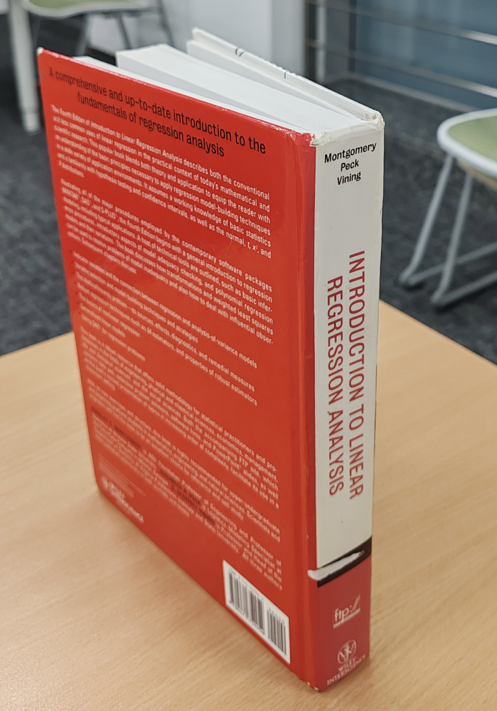</figure>

</article>

<article class="blog-entry" id="seminar">
<h2>Three years of stat & public-health seminars</h2>

2026-08-17

I am deeply grateful for the opportunity to attend seminars hosted by Dr. He and his collaborators at SJTU across three consecutive years. These photographs document moments from August 16, 2024, to August 17, 2026. Every session provided new perspectives on applying statistical methods to epidemiology and One Health.

<figure>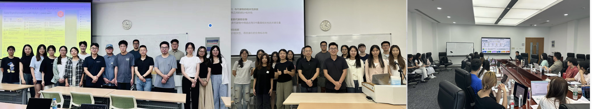</figure>

</article>

<article class="blog-entry" id="jcsds">
<h2>The 4th JCSDS and Prof. Jianqing Fan's autograph "Statistics is SURE for you"</h2>

2026-07-15

Among the inspiring talks and conversations at the 4th Joint Conference on Statistics and Data Science, one moment stood out: receiving Prof. Jianqing Fan’s autograph. I was truly honored that Prof. Fan kindly agreed to write the exact words I had suggested: “Statistics is SURE for you.” A clever nod to <em>sure screening</em> in ultrahigh-dimensional variable selection, and a personal encouragement that made the moment all the more special.

A little statistical wordplay, a lot of encouragement, and a memory I’ll surely cherish.

<figure>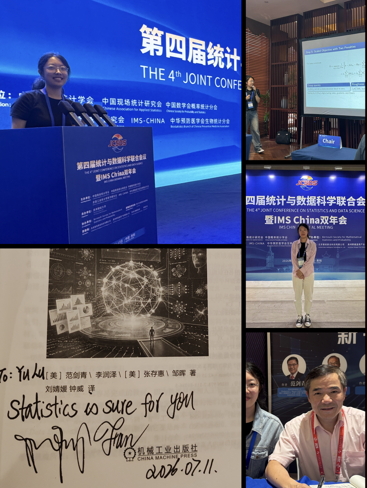</figure>

</article>

<article class="blog-entry" id="hard-code">
<h2>Does Hard Coding Matter Less Now?</h2>

<em>Mathematical expression, AI, and several productive arguments</em>

2026-06-01 · Includes later reflections and sources through October 2026

我曾经从零实现过一次因果中介分析，想弄清楚统计包内部究竟在做什么。推导数学公式、调试代码，确实让我学到了很多。不过，随着 AI 的发展，我投入精力的重点也发生了变化。作为统计学生，我越来越觉得，最有价值的能力，是把数学问题表达得足够准确，让电脑能够按照我的意思执行。

做 coursework 时，我喜欢先在纸上完成推导，再整理成 LaTeX，交给 AI。在让它写代码之前，我会先问问它对思路有什么建议：论证能不能更简洁？有没有遗漏的步骤？换一种表述会不会更好？数学说清楚了，把它转成 simulation 就顺畅多了。

熟悉几个好用的工具也很有帮助：比如做数值优化的 <code>optim</code>、画图的 <code>ggplot2</code>，再加上足以判断实现是否合理的 R 基础。我可以告诉 AI 使用哪些工具，也可以让它比较循环、<code>sapply</code> 或向量化写法。改写后到底有没有省时间，还是要实际测一下。说实话，在超级计算机面前，我这点循环改造实在有些寒酸——但我暂时还用不上超算，只好先享受这些力所能及的计算奢侈品。

科研的节奏又不一样。通常是导师提出一些想法，我去寻找相关文献，再向导师解释这些论文在做什么、如何处理问题，以及我们的问题可能处在什么位置。以我的经验，导师提出的方法通常比 GPT-6.1 想出来的更巧妙。AI 可以陪我梳理想法，而真正推动思路向前的，往往还是与导师的讨论。

两次讨论之间，我会和 AI 吵架。我把问题写下来，质疑它的方案，解释为什么它的反驳没有抓住重点，有时也会发现是自己的表述需要修改。等我说服了它——或者争论让我修改了自己的想法——再带着整理好的推理向导师汇报。让 AI 同意，只是帮助我把自己的想法说明白的一个环节。

代码实现方面的变化尤其明显。在 GPT-4 和早期 DeepSeek 那会儿，我常常需要仔细检查代码，再花上几天修改返工。到了 GPT-5.6 时期，我的体验已经很不一样：只要数学问题或科研问题表述得严谨，simulation 的整体结构几乎总是正确的。遇到偏差时，我反复发现，问题出在自己的要求还存在歧义。于是，返工的重点逐渐变成了把问题重新说清楚。

这也让我开始好奇，模型究竟是怎样学习的。DeepSeek-R1 让我关注强化学习：通过奖励反馈改善模型行为。<a href="#essay-ref-deepseek">deepseek</a>Kimi 则让我注意到知识蒸馏：学生模型从教师模型的输出或其他训练信号中学习。<a href="#essay-ref-distillation">distillation</a>, <a href="#essay-ref-kimi">kimi</a>这两种方法可以结合使用：Kimi k1.5 同时使用强化学习和蒸馏，DeepSeek 也发布了蒸馏模型。<a href="#essay-ref-kimi">kimi</a>, <a href="#essay-ref-deepseek">deepseek</a>理解这些方法，让我开始透过模型的名字，去看它们的能力是如何形成的。

这些理解之外，我也有一些很实际的使用偏好。就我目前的体验而言，Kimi 在网页搭建上简直无敌；不过，其他大多数任务似乎还是 GPT 更好一些。前一阵子，生成“鹈鹕骑自行车”动画的热潮也让我觉得很有意思：一只鸟骑得怎么样，居然成了大家判断 AI 是不是“降智了”的非正式测试。围绕这个画鹈鹕的挑战，甚至已经有了专门收集不同模型作品的项目。<a href="#essay-ref-pelican">pelican</a>

对我自己的学习和研究来说，这些变化令人振奋。数学理解让我能够指挥越来越强大的工具。我可以把更多时间用于明确假设、确定想估计的量，以及设计真正能够回答问题的实验。这些事情说得越清楚，电脑就越能发挥作用。而当问题从课程作业里的模拟走向患者的治疗结局时，准确表述问题的习惯同样重要。

</article>

<article class="blog-entry" id="warm-help-center-again">
<h2>Back at the Warm Help Center</h2>

2026-03-30

For another semester, I tutored mathematical analysis and abstract algebra every week. These meetings reminded me how much we can learn from one another by working through difficult ideas together.

<figure>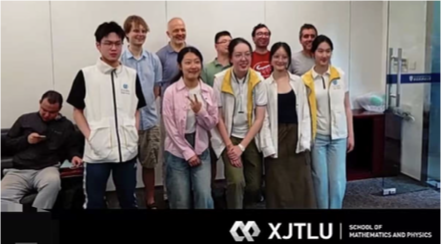</figure>

</article>

<article class="blog-entry" id="zeng-guofan">
<h2>Zeng Guofan's Six Admonitions</h2>

2026-03-24

I am grateful to Dr. He for teaching me not only academic knowledge but also how to conduct myself. He gave me this framed copy of Zeng Guofan's Six Admonitions, which I keep on my dormitory desk as a daily reminder.

<figure></figure>

</article>

<article class="blog-entry" id="travel-app">
<h2>Suzhou Smart Travel Maker</h2>

2026-03-20

With friends, I used operations research algorithms to design a <a href="https://oracle-suzhou-travel.base44.app/">web app</a> for planning a day in Suzhou. The app brings together visitor preferences, time, budget, route feasibility, and an optimization method.

<figure></figure>
<figure></figure>
<figure>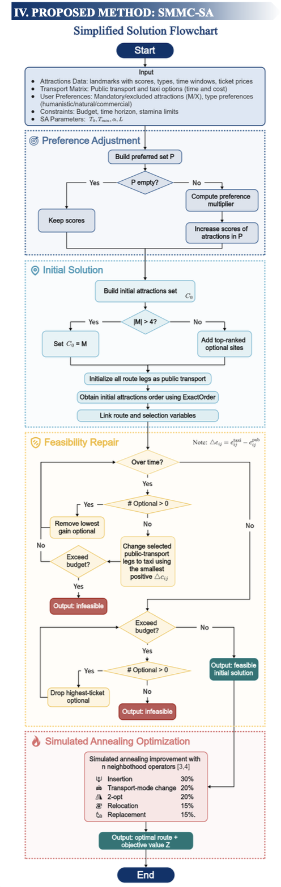</figure>

</article>

<article class="blog-entry" id="interpretable-statistics-ai">
<h2>Interpretable Statistics and Interpretable AI</h2>

2026-01-10

Kolmogorov’s axioms gave probability a firm mathematical foundation on which modern statistical inference and practice could grow. I wonder whether interpretable AI and statistics now face a similar theoretical threshold, waiting for their own “Kolmogorov moment.”

Today’s large models can feel like black boxes. Their parameter counts grow rapidly, yet scale alone may not explain the nature of intelligence. As a professor at the University of Hong Kong has argued, nature has already “open-sourced” intelligence: it develops knowledge through repeated revision and the compression of experience, rather than simply memorizing immense quantities of data. Living systems update internal representations in response to new phenomena and distill patterns that are more robust and generalizable. I see this as a metaphor for a dynamic, self-correcting process: Bayesian inference revises beliefs as evidence arrives, while evolution preserves information across generations.

This idea also runs through the history of statistics. Bayesian analysis can begin from many kinds of prior beliefs. In certain settings, maximum likelihood estimation coincides with a posterior mode under a flat prior; its direct reliance on the likelihood was itself a bold way to let observed data guide inference. These traditions differ in important ways, but each asks how data can be turned into knowledge that can be revised when new evidence appears.

Statisticians may appear to travel in different directions, yet I keep returning to one question: how do we identify and describe patterns that emerge from uncertainty? That question connects Kolmogorov’s probability axioms to today’s urgent search for explanations of AI systems.

Perhaps we need a contemporary Kolmogorov, or many of them: scholars grounded in mathematical statistics who also study structured representations, causal mechanisms, and the way knowledge is abstracted through iteration and compression. A theory of this kind could help make model reasoning more traceable, interpretable, and open to intervention, especially where medical decisions demand confidence. Future work may connect probability, causal inference, complex systems, and cognitive theory. For me, this would be more than a technical advance. It would be a return to the courage of building conceptual order amid uncertainty.

</article>

<article class="blog-entry" id="warm-help-center">
<h2>Warm Help Center: learning together</h2>

2025-12-11

Math communication concentrates not only our minds, but also our hearts. For one semester I tutored mathematical analysis and advanced linear algebra every week at the Warm Help Center.

<figure>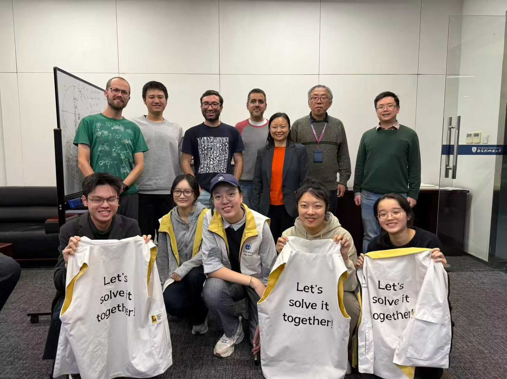</figure>

</article>

<article class="blog-entry" id="math-stat-empathy">
<h2>Math/Stat-related things has empathized me a lot</h2>

2025-09-01

Why do I like mathematical analysis so much? Is it because teachers really sophisticated in it so that tell stories well? Is it because I was always bored in my sophomore year and enjoyed seeking out problems, consulting teachers, and then chatting with them? Is it because I liked to use different counterexamples to view theorems but had to reluctantly accept the fact that I would never be able to come up with counterexamples myself? Is it because I enjoyed thinking about the same problem in various ways and marveled at the charm of scholarship? Is it because during the final exam, the Archimedean Property made 1/n fall within the delta of uniform continuity, and prove the result in the last second of the exam? Is it because I took pride in the intuitive drawing of sequence approximation, which allowed me to see the result at a glance before the proof? Or is it because I was amazed by the simple derivation of the volume of an n-dimensional sphere using recurrence iterated integrals? Is it because I realized that even the historically rigorous differential equations can only approximately describe nature, and thus I gladly accepted my own insignificance? Is it because I admired the teachers who, despite often being confused about the meaning of life, still resolutely pursued the path of applied and pure mathematics? Or is it because I was immersed in the little stories told by teachers that combined mathematical principles with life lessons, such as Minkowski, who, suffering from appendicitis and on his deathbed, lamented that he was dying in an era when the theory of relativity was being developed—compared to these stories, all regrets seemed to vanish.

Statistics is a beneficial and interesting subject and I feel so lucky to major in BioStatistics.

</article>

<article class="blog-entry" id="spring-ride">
<h2>A spring ride by the lake</h2>

2025-03-22

A 36 km ride under warm sunlight. A cool breeze carried the scent of grass and lake water; shops offered steaming qingtuan and spring bamboo shoots. The day felt full of possibility.

<figure>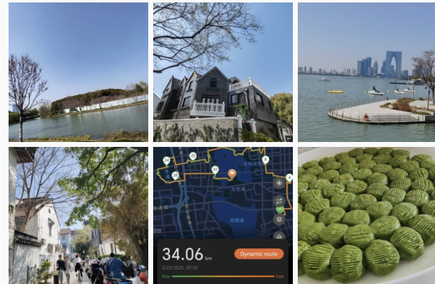</figure>

</article>

<article class="blog-entry" id="michael-levitt">
<h2>A wonderful life in science</h2>

2024-10-09

Nobel laureate Prof. Michael Levitt of Stanford University visited Xi'an Jiaotong-Liverpool University. His research used computational algorithms to study biological questions, helping pioneer molecular dynamics simulations of proteins and DNA and contributing to protein structure prediction. I got a front-row seat. Does that mean I am one step closer to Stanford Statistics? Just joking—but the talk made the possibility feel a little closer.

<figure>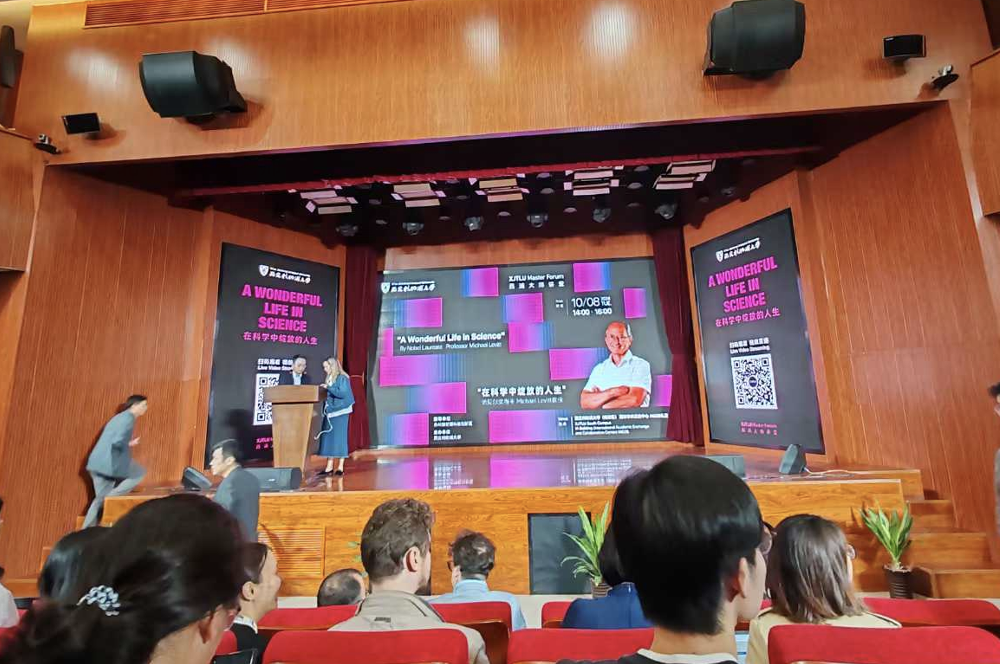</figure>

</article>

<article class="blog-entry" id="akun">
<h2>Wednesday mathematics by Prof. Akun</h2>

2024-09-25

I am grateful to Prof. Chi-Kun Lin (Akun) for his Wednesday evening classes, where mathematical analysis, linear algebra, ODEs, PDEs, and philosophy meet. Today I went to his office with two like-minded applied mathematics classmates. We kept asking questions until 11:30 p.m. and saw his beautifully organized mathematics notes from 1985. I came away with so much. Akun is a wonderful storyteller!

<figure>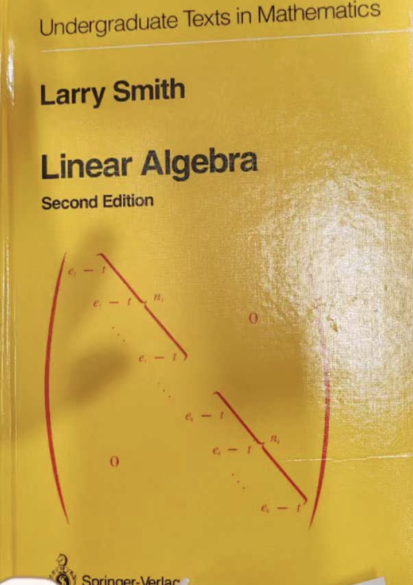</figure>
<figure>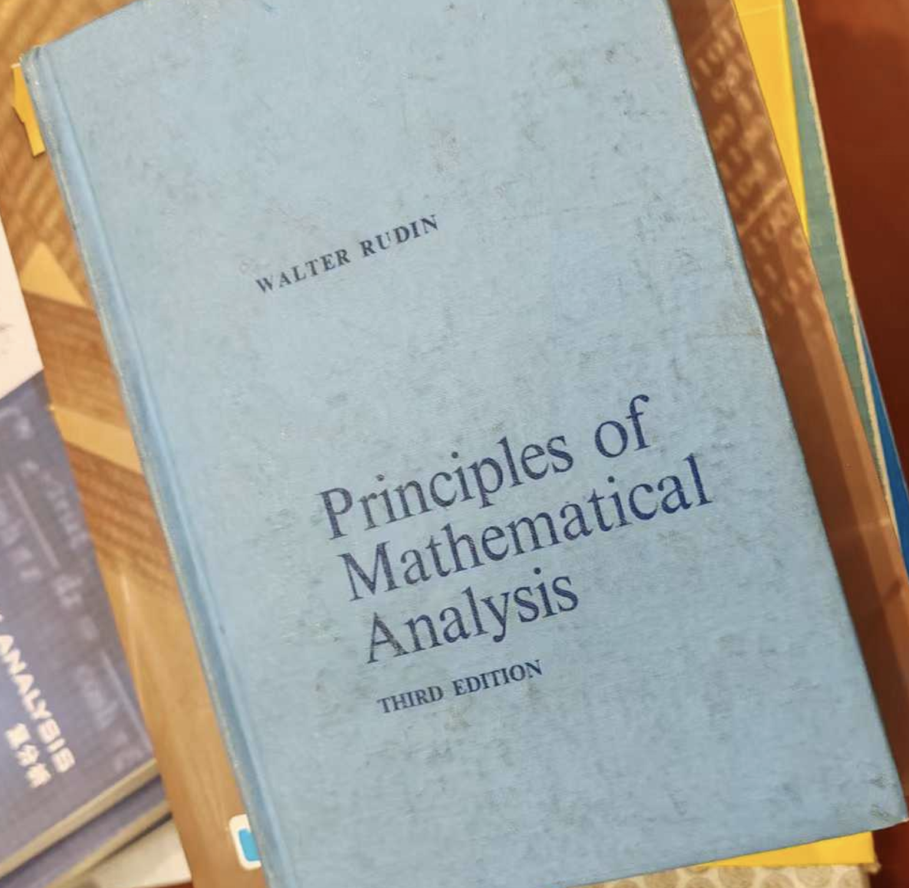</figure>
<figure>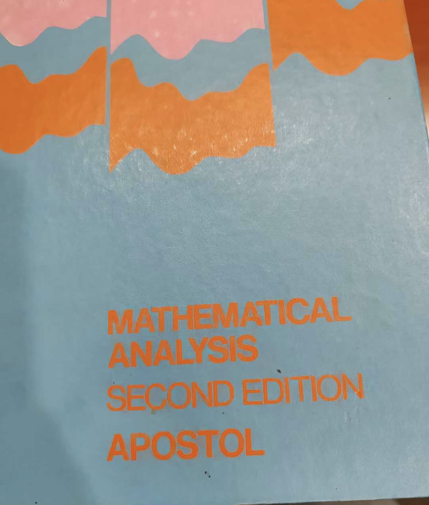</figure>
<figure>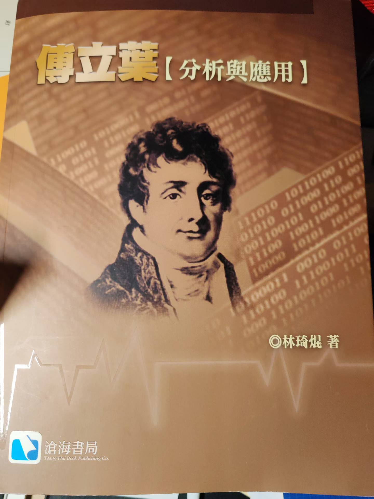</figure>
<figure></figure>

Later, shortly before Akun left XJTLU, I had the honor of attending his seminars and receiving a personally signed copy of his book.

</article>

<article class="blog-entry" id="uniform">
<h2>Uniform generates everything</h2>

2024-07-26

Uniform generates everything opens my statistics journal. I feel fortunate to study under scholars whose academic genealogy traces back to Karl Pearson. Their generous guidance has meant a great deal to me.

<figure></figure>

</article>

<article class="blog-entry" id="youth">
<h2>Youth and adventure</h2>

2024-03-26

“Youth means a temperamental predominance of courage over timidity of the appetite, for adventure over the love of ease.”

<figure></figure>

</article>

<section class="blog-references" id="essay-references">
<h2>References for the three essays</h2>
<ol>
<li id="essay-ref-deepseek"><a href="https://arxiv.org/abs/2501.12948">DeepSeek-R1: Incentivizing Reasoning Capability in LLMs via Reinforcement Learning</a></li>
<li id="essay-ref-distillation"><a href="https://arxiv.org/abs/1503.02531">Distilling the Knowledge in a Neural Network</a></li>
<li id="essay-ref-kimi"><a href="https://arxiv.org/abs/2501.12599">Kimi k1.5: Scaling Reinforcement Learning with LLMs</a></li>
<li id="essay-ref-plm"><a href="https://doi.org/10.1073/pnas.2016239118">Biological Structure and Function Emerge from Scaling Unsupervised Learning</a></li>
<li id="essay-ref-vaccineoverview"><a href="https://www.merck.com/news/merck-and-moderna-announce-phase-3-interpath-001-trial-of-intismeran-autogene-plus-keytruda-met-endpoints-of-recurrence-free-survival-rfs-and-distant-metastasis-free-survival-dmfs-in-patient/">Merck and Moderna: Phase III INTerpath-001 Announcement (August 2026)</a></li>
<li id="essay-ref-neoantigens"><a href="https://www.nature.com/articles/nature23003">Personalized RNA Mutanome Vaccines Mobilize Poly-specific Therapeutic Immunity against Cancer</a></li>
<li id="essay-ref-vaccineresults"><a href="https://www.merck.com/news/merck-and-moderna-will-present-results-from-landmark-phase-3-interpath-001-trial-for-intismeran-autogene-plus-keytruda-pembrolizumab-at-esmo-2026-presidential-symposium/">Merck and Moderna: Detailed INTerpath-001 Results (October 2026)</a></li>
<li id="essay-ref-cox"><a href="https://web.stanford.edu/~lutian/coursepdf/cox1972paper.pdf">Regression Models and Life-Tables</a></li>
<li id="essay-ref-causal"><a href="https://miguelhernan.org/whatifbook">Causal Inference: What If</a></li>
<li id="essay-ref-ni"><a href="https://www.fda.gov/regulatory-information/search-fda-guidance-documents/non-inferiority-clinical-trials">FDA: Non-Inferiority Clinical Trials to Establish Effectiveness</a></li>
<li id="essay-ref-casi"><a href="https://hastie.su.domains/CASI/">Computer Age Statistical Inference: Algorithms, Evidence, and Data Science</a></li>
<li id="essay-ref-bootstrap"><a href="https://blogs.helsinki.fi/bk-club/files/2012/05/Efron_Bootstrap_AS1979.pdf">Bootstrap Methods: Another Look at the Jackknife</a></li>
<li id="essay-ref-coxreflection"><a href="https://garfield.library.upenn.edu/classics1986/A1986E291500001.pdf">Cox: Retrospective Commentary on Regression Models and Life-Tables</a></li>
<li id="essay-ref-popper"><a href="https://arxiv.org/abs/2502.09858">Automated Hypothesis Validation with Agentic Sequential Falsifications</a></li>
<li id="essay-ref-safe"><a href="https://arxiv.org/abs/1906.07801">Safe Testing</a></li>
<li id="essay-ref-e9"><a href="https://www.fda.gov/regulatory-information/search-fda-guidance-documents/e9-statistical-principles-clinical-trials">ICH E9 Statistical Principles for Clinical Trials</a></li>
<li id="essay-ref-savi"><a href="https://arxiv.org/abs/2210.01948">Game-Theoretic Statistics and Safe Anytime-Valid Inference</a></li>
<li id="essay-ref-pelican"><a href="https://github.com/simonw/pelican-bicycle">Pelicans on a Bicycle</a></li>
</ol>
</section>
